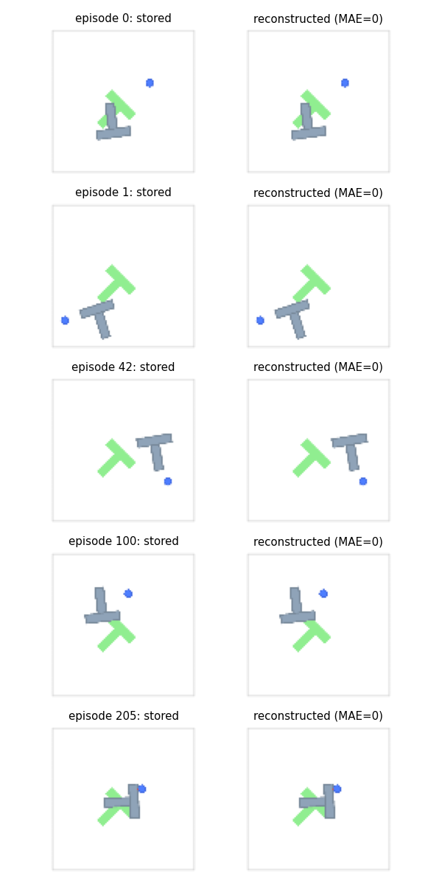

# Push-T data audit

Audit time: 2026-10-20T12:47:35.539263+00:00

Dataset: `D:\Code\Course_code\DP\diffusion_policy\data\pusht\pusht_cchi_v7_replay.zarr`

206 episodes / 25650 frames; lengths min/median/max: 49/122.0/246.

| Array | Shape | dtype | min | max |
|---|---|---|---:|---:|
| action | [25650, 2] | float32 | 12.0 | 511.0 |
| img | [25650, 96, 96, 3] | float32 | 65.0 | 255.0 |
| keypoint | [25650, 9, 2] | float32 | 12.201386451721191 | 521.0679321289062 |
| n_contacts | [25650, 1] | float32 | 0.0 | 2.0 |
| state | [25650, 5] | float32 | 0.00021559125161729753 | 510.9578857421875 |

All arrays have equal frame count and finite values. Images are float32 but integer-valued; conversion to uint8 is lossless.

## Temporal and coordinate evidence

`demo_pusht.py:88-103` appends current image/state and current mouse target before env.step(act). Offset is zero.
`pusht_env.py:46-52,103-121` defines [0,512]^2 absolute targets and PD acceleration k_p*(action-agent.position).
`pusht_image_dataset.py:85-94` uses state[..., :2] and moves RGB HWC to CHW /255 without temporal shift.
`MultiStepWrapper` stacks oldest to latest; ALT uses the latest only and returns [B,8,2].

| Episode | Frame | Source | agent_pos_t | action_t | next agent_pos | pixel MAE |
|---:|---:|---:|---|---|---|---:|
| 0 | 20 | 20 | [348.5765380859375, 190.74172973632812] | [360.0, 221.0] | [353.56915283203125, 203.03469848632812] | 0.0 |
| 1 | 20 | 181 | [49.78565979003906, 411.51318359375] | [54.0, 422.0] | [51.465023040771484, 416.0703125] | 0.0 |
| 42 | 20 | 5309 | [412.8558654785156, 366.3203125] | [441.0, 340.0] | [424.8766784667969, 356.1077575683594] | 0.0 |
| 100 | 20 | 11864 | [272.9882507324219, 145.34034729003906] | [256.0, 138.0] | [266.3855895996094, 141.5692901611328] | 0.0 |
| 205 | 20 | 25621 | [321.28369140625, 220.42507934570312] | [299.0, 212.0] | [312.2066345214844, 216.7042999267578] | 0.0 |

Stored body poses must be reconstructed with legacy=False to avoid applying the initial-state center-of-mass rotation twice. This is a diagnostic only; official test initializations use legacy_test=True.

## Split contract and feasibility

Reserve 20 whole episodes before selection; train pool = 186. Use PCG64 ordering with split seed 42. Exact IDs and 50 environment seeds are frozen in `experiments/splits/pusht_v7_split42.json`.
30 and 100 are feasible nested prefixes. 300 and 500: **NOT_FEASIBLE_WITH_CURRENT_DATA**. Additional collection/alternative data requires separate user authorization.
All 206 episodes support unpadded 8-action chunks (24208 starts). Repeat-last padding permits all 25650 frames without episode crossing.

## Integrity and evaluation

Full-byte hash computed over 819 files / 31010783 bytes: `9b8c01cfa9d217337d1bad6cc84f81a0d8e1187b918acf0c76af0c08e9b110ee`.
Definition: SHA256(sorted(relative_posix_path + NUL + file_sha256 + LF)). Split SHA256: `1b786b545a200f8fbbb28fb9385bc1ff80ed8699aba7c14d6fd117af7670322a`.
Official image-task config: seeds 100000..100049, max_steps=300, legacy_test=True. Score is mean per-episode maximum reward, reward=clip(coverage/0.95,0,1). No invented binary success threshold.
No train/validation-fitted normalizer is necessary: ImageNet statistics and fixed position bounds only. Original action targets are unchanged.
Reference commits and tracked-file integrity hashes are in results/reference_snapshot.json. No DP model is trained.
