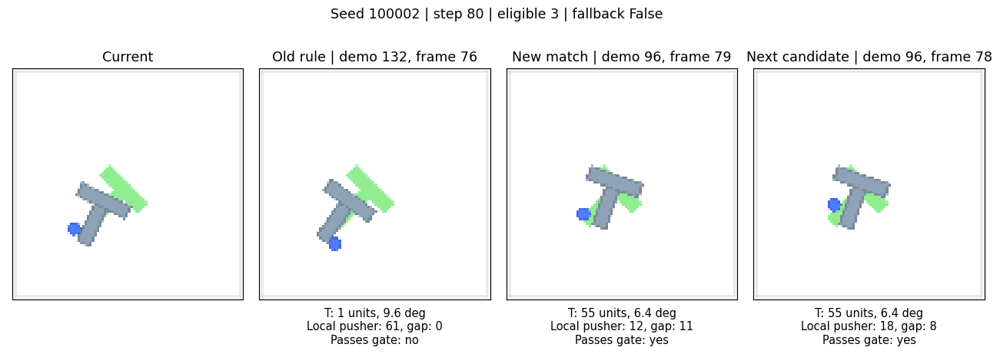

# Push-T 当前帧与训练候选图集

蓝色圆点是推杆，灰色 T 是物体，绿色 T 是目标。右侧的匹配帧来自冻结训练示范。按同一行比较当前和匹配画面，先看推杆在 T 的哪一侧，再看 T 的位置和朝向。几何误差的距离使用 512×512 世界坐标，角差使用度。

## 视觉 ALT 与位姿监督

| 方法 | 对照图 | 图中可以核对什么 |
| --- | --- | --- |
| 原视觉 ALT-30 | [当前帧与检索帧](../results/visualizations/test_frame_matches_v1_alt30.png) · [逐帧来源](../results/visualizations/test_frame_matches_v1.json) | 种子 100000 的第 8、160、296 步，各自实际检索的训练帧 |
| 原视觉 ALT-100 | [当前帧与检索帧](../results/visualizations/test_frame_matches_v1_alt100.png) · [逐帧来源](../results/visualizations/test_frame_matches_v1.json) | 与 ALT-30 同种子、同查询步，各策略实际到达的状态可不同 |
| B1 位姿监督 | [闭环当前帧与检索帧](../experiments/fixed_alt_encoder/results/visualizations/b1_test_matches_v1.png) · [验证帧同图对比](../experiments/fixed_alt_encoder/runs/b1_alt030_split42_model42_pose1_pilot_v1/heldout_match_comparison.png) | 闭环图与原视觉基线使用相同取点。离线图把同一个验证查询与两个模型的结果并排 |
| B1 重复动作 | [动作块对照](../experiments/fixed_alt_encoder/results/visualizations/b1_test_matches_v1_repetition.png) · [逐步解释](../experiments/fixed_alt_encoder/docs/test_match_visualization.md) | 第 152、160、168 步反复命中示范 54 的第 113 帧，紫线是动作目标顺序 |

闭环图的当前帧取自对应 rollout 的视频，可能带动作标记和视频压缩。离线图从数据集取帧。[训练时的对比正负样本](../results/visualizations/contrastive_training_pairs_v1.png)解释编码器如何训练。

## 全局几何真值检索

- [前四个种子的当前帧与实际匹配](../experiments/geometry_oracle_alt/results/figures/current_vs_matches.png)
- [种子 100000，第 296 步](../experiments/geometry_oracle_alt/results/figures/query_seed100000_step296.png)的推杆误差约 0.0006，T 块位置差约 58、朝向差约 35.8°。[案例说明与来源](../experiments/geometry_oracle_alt/matching_summary.md)
- [种子 100001 的重复动作块](../experiments/geometry_oracle_alt/results/figures/seed100001_chunk_cycle.png)展示反复检索同一示范帧的情形。

## 相对几何与同边筛选

两组各保存 12 张对照图。每张从左至右显示**当前 RGB、旧全局规则对该画面的匹配、新规则实际选中的帧、下一候选**。若只有一条合格候选，则省略最后一列。每张图旁的同名 JSON 保存查询状态、轨迹及帧索引、几何误差和是否启用了回退。两组在第 0 步共享起点，后续可能走到不同状态。同一张图的旧、新列对应同一个查询。

上图中，旧规则的 T 位置误差约 1 个单位，推杆相对 T 的误差约 61。新规则将后者降到约 12，选中的 T 位置则偏了约 55 个单位。第 0 步的部分图组也展示了库里没有合格候选时的回退结果。

| 种子 | 查询步 | 相对几何 | 同边筛选 |
| --- | ---: | --- | --- |
| 100000 | 0 | [对照图](../experiments/pusht_contact_matching/results/contact_match_v2/relative/seed100000_step000.png) | [对照图](../experiments/pusht_contact_matching/results/contact_match_v2/gated/seed100000_step000.png) |
| 100000 | 80 | [对照图](../experiments/pusht_contact_matching/results/contact_match_v2/relative/seed100000_step080.png) | [对照图](../experiments/pusht_contact_matching/results/contact_match_v2/gated/seed100000_step080.png) |
| 100000 | 160 | [对照图](../experiments/pusht_contact_matching/results/contact_match_v2/relative/seed100000_step160.png) | [对照图](../experiments/pusht_contact_matching/results/contact_match_v2/gated/seed100000_step160.png) |
| 100001 | 0 | [对照图](../experiments/pusht_contact_matching/results/contact_match_v2/relative/seed100001_step000.png) | [对照图](../experiments/pusht_contact_matching/results/contact_match_v2/gated/seed100001_step000.png) |
| 100001 | 80 | [对照图](../experiments/pusht_contact_matching/results/contact_match_v2/relative/seed100001_step080.png) | [对照图](../experiments/pusht_contact_matching/results/contact_match_v2/gated/seed100001_step080.png) |
| 100001 | 160 | [对照图](../experiments/pusht_contact_matching/results/contact_match_v2/relative/seed100001_step160.png) | [对照图](../experiments/pusht_contact_matching/results/contact_match_v2/gated/seed100001_step160.png) |
| 100002 | 0 | [对照图](../experiments/pusht_contact_matching/results/contact_match_v2/relative/seed100002_step000.png) | [对照图](../experiments/pusht_contact_matching/results/contact_match_v2/gated/seed100002_step000.png) |
| 100002 | 80 | [对照图](../experiments/pusht_contact_matching/results/contact_match_v2/relative/seed100002_step080.png) | [对照图](../experiments/pusht_contact_matching/results/contact_match_v2/gated/seed100002_step080.png) |
| 100002 | 160 | [对照图](../experiments/pusht_contact_matching/results/contact_match_v2/relative/seed100002_step160.png) | [对照图](../experiments/pusht_contact_matching/results/contact_match_v2/gated/seed100002_step160.png) |
| 100003 | 0 | [对照图](../experiments/pusht_contact_matching/results/contact_match_v2/relative/seed100003_step000.png) | [对照图](../experiments/pusht_contact_matching/results/contact_match_v2/gated/seed100003_step000.png) |
| 100003 | 80 | [对照图](../experiments/pusht_contact_matching/results/contact_match_v2/relative/seed100003_step080.png) | [对照图](../experiments/pusht_contact_matching/results/contact_match_v2/gated/seed100003_step080.png) |
| 100003 | 160 | [对照图](../experiments/pusht_contact_matching/results/contact_match_v2/relative/seed100003_step160.png) | [对照图](../experiments/pusht_contact_matching/results/contact_match_v2/gated/seed100003_step160.png) |

[相对几何图片与元数据目录](../experiments/pusht_contact_matching/results/contact_match_v2/relative/) · [同边筛选图片与元数据目录](../experiments/pusht_contact_matching/results/contact_match_v2/gated/)

## 其他可视化与复核入口

- B2-B 的[最近邻与候选覆盖](../experiments/geometry_sampling_analysis/figures/nearest_neighbors.png)、[采样示例](../experiments/geometry_sampling_analysis/figures/sampling_examples.png)和[覆盖率图](../experiments/geometry_sampling_analysis/figures/candidate_coverage.png)用于解释离线样本可用性。
- [动作坐标迁移正反例](../experiments/pusht_action_transfer/RESULTS.md)固定同一训练帧，只比较动作如何搬到当前 T 的坐标系。这个实验的证据是接触点、转向和逐段得分。
- [实验结果总览](pusht_results.md)汇集整局分数、离线诊断和解释边界。
