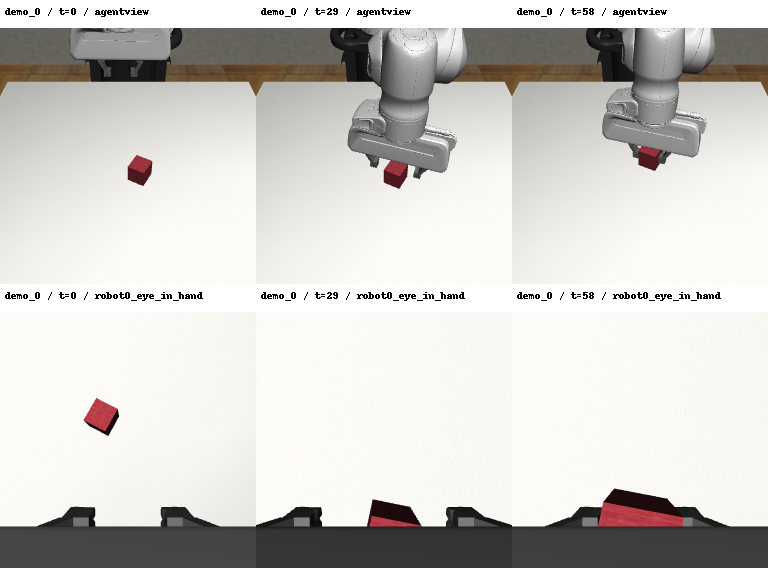

# 与旧版 Lift/PH 数据匹配的仿真环境

状态：已安装并验证环境启动、状态恢复和双相机渲染；三条固定示范均成功抬起物体。
连续动作回放存在微小数值偏差，**没有通过 1e-5 的严格完整状态检查**；此限制已保留，不能声称历史轨迹完全一致。

本配置只负责数据读取、环境启动、示范回放和图像渲染，不训练模型。
所有安装内容在 `artifacts/environments/robomimic_lift_legacy/`，原有 Push-T 环境及 ACl/DP 源码保持不变。
系统编译与 Mesa 依赖安装在本机已有 WSL2 Ubuntu 中；独立 Python、MuJoCo 引擎和包均位于上述 D 盘项目目录。

## 版本依据

下载的是 robomimic **0.2.0** 注册的旧版 Lift / PH / low_dim 数据，不能直接把当前最新版 robosuite 当作兼容版本。
[旧版官方数据文档](https://robomimic.github.io/docs/v0.2/datasets/robomimic_v0.1.html) 要求 robosuite `offline_study` 分支。
配置冻结为：

| 组件 | 版本 |
|---|---|
| 平台 | 已有 WSL2 Ubuntu，Linux x86_64 |
| Python | 3.8.20，项目内独立安装 |
| robomimic | 0.2.0 |
| robosuite | 1.2.0，offline_study，Commit d9baa17d5328d7b0ec15ecda54c76c61bb983124 |
| MuJoCo | 2.0.0，官方旧版引擎 |
| mujoco-py | 2.0.2.9，与该源码包 setup.py 声明一致 |
| 渲染 | CPU / OSMesa，支持离屏 RGB |

实际宿主为 Ubuntu 26.04 / glibc 2.43 / GCC 15。旧包的构建兼容参数见 runtime.sh、link_gcc.sh；没有修改物理引擎。
旧 CPU Torch 库的可执行栈标记不被新 glibc 接受：fix_torch_stack.py 保留原件，只清除 ELF 中这一个标记字节，并记录前后 SHA256；导入和 CPU 张量检查通过。

同一上游分支的 requirements.txt 写的是 mujoco-py 2.0.2.13，与 setup.py 不一致；本配置先遵循 setup.py 的 2.0.2.9。
数据文件没有保存采集时确切的 Git Commit 或 mujoco-py 版本，因此依据官方兼容分支选择版本，并实际验证回放；不把它描述为已证明历史环境逐字节一致。
Python 使用兼容旧依赖的 3.8.20；官方旧版推荐 3.7.9、最低 3.6，Python 本身不是 MuJoCo 物理引擎版本。

MuJoCo 2.0 使用官方公开的免费激活文件，依据[官方许可](https://www.roboti.us/license.html)下载，仅本地保存，不提交 Git。
robosuite 为 MIT，原许可保留在本地安装源码中；本项目脚本独立编写，通过已安装包调用接口。

## 在 Windows PowerShell 中执行

需已有 WSL Ubuntu。系统依赖安装会修改 WSL 中的包，因此需具备相应授权：

```powershell
wsl.exe -d Ubuntu -u root -- bash -lc 'apt-get update && DEBIAN_FRONTEND=noninteractive apt-get install -y --no-install-recommends build-essential libosmesa6-dev libgl1-mesa-dev libglew-dev patchelf'
powershell.exe -NoProfile -ExecutionPolicy Bypass -File environments/robomimic_lift/run.ps1 -Stage setup
powershell.exe -NoProfile -ExecutionPolicy Bypass -File environments/robomimic_lift/run.ps1 -Stage validate
```

`-ExecutionPolicy Bypass` 仅用于当前 PowerShell 进程，不改动用户或系统执行策略。
如果自动化受限子进程没有 WSL 服务访问权限，需要通过工具授权执行；不要修改 WSL 账户权限来掩盖该限制。
也可以在正常用户的 WSL 终端中，在项目根目录执行：

```bash
bash environments/robomimic_lift/setup_wsl.sh
bash environments/robomimic_lift/validate_wsl.sh
```

安装完成后，在 WSL 的项目根目录使用此环境运行自己的程序：

```bash
source environments/robomimic_lift/runtime.sh
"$LIFT_ENV_ROOT/venv/bin/python" -B your_script.py
```

如需在新机器下载相同的数据，在 setup 完成后执行：

```bash
source environments/robomimic_lift/runtime.sh
"$LIFT_ENV_ROOT/venv/bin/python" -B -m robomimic.scripts.download_datasets --tasks lift --dataset_types ph --download_dir "$LIFT_PROJECT_ROOT/artifacts/datasets/robomimic"
```

文件应位于 config.json 中的路径，并通过其中的完整 SHA256 检查。

代码/小结果会提交 Git；Python 环境、引擎、完整依赖源码、缓存、原始数据和激活文件均不提交。
如果迁移工作区，重新运行 setup 建立环境；独立环境的路径不能直接从另一台机器复制后假设可用。

## 如何验证兼容性

`validate.py` 对固定的 demo_0、demo_1、demo_2 做两种不同检查：

1. 恢复每一帧的 MuJoCo 状态，比较 HDF5 中全部低维观测；最大绝对误差需不超过 1e-6。
2. 只加载初始状态，连续执行所有记录的动作；中途不恢复示范状态，记录完整状态误差、物体观测误差和 Lift 任务成功信号。完整状态最大绝对误差门限 1e-5。

另外验证 agentview 和 robot0_eye_in_hand 两台相机的离屏图像，保存第一条示范的首/中/末画面。
这些是专家示范回放测试，不是学习策略的泛化成功率，不应当作为 DP/ALT 的训练结果。
每次验证建立独立时间戳目录，保留失败记录；简要结果位于本目录的 results/。

## 实测结果与限制

2026-10-22，固定随机种子 0，验证总计 174 帧，未训练网络：

| 示范 | 恢复状态后最大观测误差 | 连续回放最大完整状态误差 | 物体位置最大欧氏误差（毫米） | 物体姿态最大误差（度） | 最终 Lift 成功 |
|---|---:|---:|---:|---:|---|
| demo_0 | 1.11e-16 | 3.03e-8 | 2.64e-7 | 数值精度内为 0 | 是 |
| demo_1 | 1.67e-16 | 8.75e-4 | 0.003139 | 0.005768 | 是 |
| demo_2 | 1.11e-16 | 2.65e-4 | 0.000553 | 0.000926 | 是 |

两次回放的最大完整状态误差一致；第二次仅增加诊断，不改变动作、环境参数或门限。
demo_1 / demo_2 的最大误差均在动作索引 48 的物体角速度分量，分别从索引 47 / 48 超过严格门限。
完整状态向量混有时间、关节位置和速度，不能把该最大误差直接解释为米或厘米。

`env.step()` 返回的 object 观测与文件观测存在约 0.0013 的分量差异。通过另一个只读比较用的 MjSim 从当前状态重新计算几何后，三条误差分别为 3.60e-10、5.02e-5、7.37e-6；这说明原返回值还受该旧环境的观测更新时间影响。没有修改原版 step 或以此替换策略的标准观测。

**实际结论：** 数据状态可以恢复，示范动作可成功执行，相机可正常使用；严格逐状态一致性未通过。
**推测：** 微小数值差异在抓取接触后放大，可能涉及跨平台数值计算或未存入状态向量的内部量；目前没有单独证明唯一根因。
**后续使用：** 可继续做环境开发与渲染；若研究要求严格动作回放一致，应先解决并重新验证此项限制。当前 validate 命令仍返回非零状态，保留原严格门限，不把任务成功代替它。

实际结果见 [validation.json](results/validation.json)，首次结果见 [initial_validation.json](results/initial_validation.json)，离线误差分解见 [replay_diagnosis.json](results/replay_diagnosis.json)。
图中为逐帧恢复数据状态后的渲染，不是学习策略的轨迹：



逐步误差分解可以用同一 WSL Python 重跑：

```bash
source environments/robomimic_lift/runtime.sh
"$LIFT_ENV_ROOT/venv/bin/python" -B environments/robomimic_lift/summarize_replay.py
```

## HDF5 存了什么

可以把 HDF5 看作一个二进制容器：一个文件里有“文件夹”（group）和多维数组（dataset），通常用 Python `h5py` 读取。
当前文件有 200 条示范、9,666 帧：

```text
low_dim.hdf5
├── data
│   ├── demo_0
│   │   ├── obs / next_obs  物体、末端、夹爪和关节等低维观测
│   │   ├── actions         [T, 7] 末端平移/旋转与夹爪控制
│   │   ├── states          [T, 32] 原始 MuJoCo 仿真状态
│   │   ├── rewards / dones 奖励与终止标记
│   │   └── model_file      XML 模型属性
│   └── 其余 demo
└── mask                    原有训练/验证 Episode 名称
```

具体字段如 `robot0_eef_pos`（3维）、`robot0_eef_quat`（4维）、末端速度、关节位置/速度、夹爪状态和 `object`（10维）。
当前文件不含相机图像；状态和 XML 可用于兼容环境中的重放和渲染。
这里的 7 维动作来自 OSC_POSE 的增量控制及夹爪命令，不能沿用 Push-T 的 2 维绝对 xy 动作接口。

## 未来 DP / ALT 如何使用

这是方法设计建议，没有创建新划分，也没有启动训练：

- 直接沿用原 mask/train 的 180 条和 mask/valid 的 20 条，以完整 Episode 为单位隔离。
- 做数据规模比较时，可在这 180 条里冻结一次 Episode 顺序，保存如 30 ⊂ 50 ⊂ 100 ⊂ 180 的具体 ID；300/500 条不适用于当前 PH 文件。
- DP 与 ALT 应使用同一训练/验证 Episode、同样的观察信息，以及未来单独冻结的仿真测试初始状态/Seeds。
- 归一化参数仅在当前训练子集拟合；ALT 的 Memory Bank 也只能包含训练子集。
- 低维版可读取选择好的 obs；视觉版需要对应图像和机器人本体状态。DP 学习条件动作序列；ALT 学习表征后检索训练示范动作，需要各自适配 7 维控制接口。
- 训练/验证损失与仿真闭环表现分别报告；本配置的专家回放不能代替学习策略测试。

执行、失败和修复细节见 [execution_log.md](execution_log.md)。
