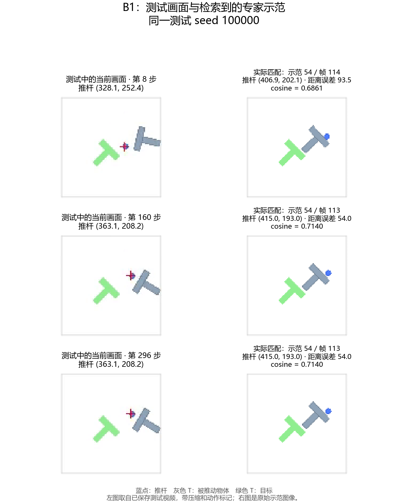
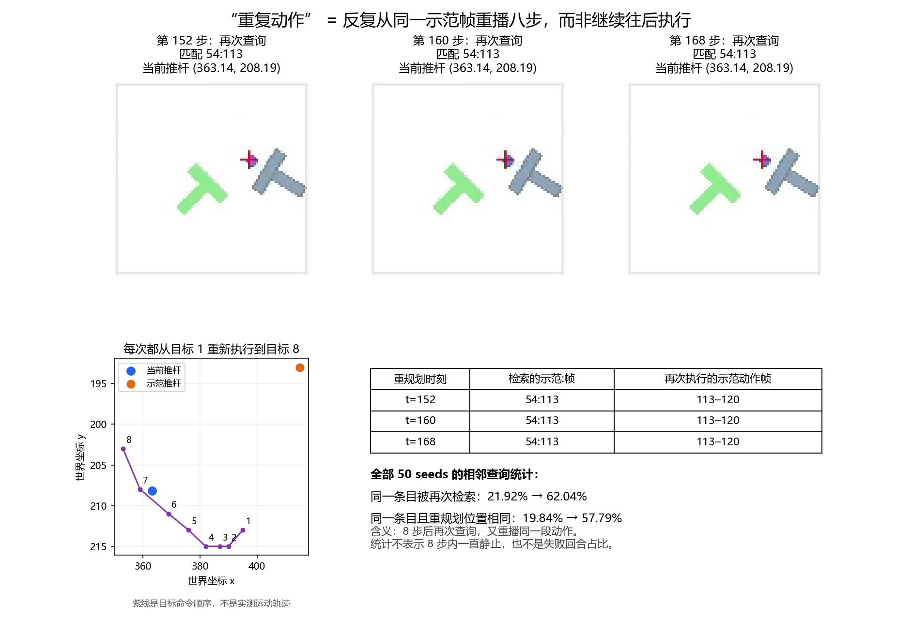

# B1 测试画面、匹配示范与重复动作

本次只读取已完成的 B1 正式测试视频和检索日志，没有新训练或新 rollout。
固定示例为原定视频 seed 100000；步骤 8、160、296 与原基线可视化取点一致。



每行左边是测试当时的画面，右边是实际检索到的专家示范帧。蓝点是推杆，灰色 T
是物体，绿色 T 是目标。坐标来自检索日志/源数据；测试画面来自压缩视频并带有动作
渲染标记，不能称为无损保存的 Encoder 输入张量。查询步骤 t 对应视频索引 t-1。

“xy 匹配变弱”更准确的含义是：检索到的示范推杆位置与当前推杆位置更不一致。
在同一验证集上平均距离误差 39.85→46.63 世界单位。数值 xy 替换的 Top-1 改变率
实际由 1.56% 略升至 2.34%，仍很弱；这些指标不直接测量网络权重大小。



策略每执行 8 步重新观察和查询。如果新查询又返回同一个 episode/frame，便从同一
源帧重新取出相同的八步绝对位置目标，并不自动把示范播放指针向后移动。

| 测试时刻 | 本次匹配 | 本次执行的示范动作帧 |
|---|---|---|
| 152 | episode 54 / frame 113 | 113–120 |
| 160 | episode 54 / frame 113 | 113–120 |
| 168 | episode 54 / frame 113 | 113–120 |

三次查询的当前推杆均为 (363.138977,208.194061)，而示范推杆为
(414.974670,193.046219)，相距约 54.00 世界单位。八步目标命令逐项完全相同。
图中的紫线只表示目标执行顺序，不能当作实测推杆运动轨迹。

全部 50 seeds 中，相邻查询返回同一条目的占比为 400/1825=21.92%（原 ALT-30）
与 1139/1836=62.04%（B1）。若还要求重规划时推杆距离变化 <=0.001 世界单位，
则为 362/1825=19.84% 与 1061/1836=57.79%。这是查询转移比例，不是失败回合
比例，也不说明八步之间完全静止。结合视频，这个示例体现了反复重播同一动作块、
任务无法持续推进；并未证明 xy 误差是这一现象的唯一原因。

生成命令（现有输出拒绝覆盖；复跑请换 `--output-name`）：

```powershell
& 'D:\Code\Course_code\DP\.conda\pusht\python.exe' -B scripts/visualize_test_matches.py
```

源视频、检索日志、脚本与输出的 SHA256，以及所有展示动作和源索引，保存在
[可视化清单](../results/visualizations/b1_test_matches_v1.json)。生成时逐项核对了
动作、episode/frame/global-index 映射，并校验了原始视频和日志的已有 hash。
