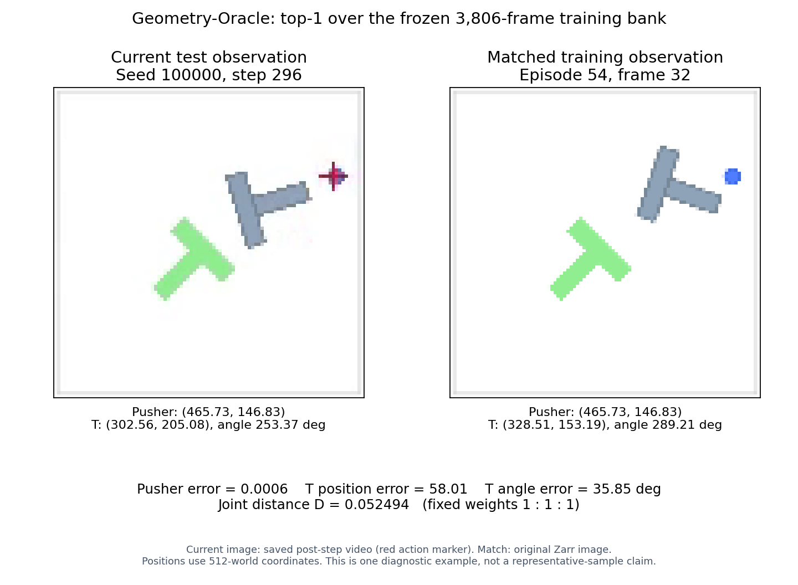

# 规则检索的几何匹配情况

本页仅分析已保存的 Geometry-Oracle ALT-30 结果，没有训练或新增闭环评测。
候选库始终为冻结的 30 条训练 Episode、3,806 帧；真实五维状态属于特权输入。

## 误差分布

位置采用 512 世界坐标单位；角度采用周期角误差（度）。数值为查询与所选训练帧之间的误差，不是分类准确率。

| 查询来源 | 几何分量 | 平均 | 中位数 | P95 |
|---|---|---:|---:|---:|
| 离线验证集，2,426 帧 | 推杆位置 | 22.96 | 14.98 | 72.37 |
| 离线验证集，2,426 帧 | T块位置 | 29.17 | 20.36 | 87.54 |
| 离线验证集，2,426 帧 | T块角度 | 8.31° | 4.42° | 33.07° |
| 闭环测试，50 Seeds、1,863 次查询 | 推杆位置 | 47.37 | 44.84 | 107.95 |
| 闭环测试，50 Seeds、1,863 次查询 | T块位置 | 64.45 | 63.41 | 107.34 |
| 闭环测试，50 Seeds、1,863 次查询 | T块角度 | 14.78° | 12.40° | 35.89° |

对相同离线验证帧，原视觉 ALT 的平均误差为推杆 39.85、T位置 46.42、角度 38.31°；规则检索三项都更低。
闭环时面对的是策略实际走到的状态，其最近候选仍可能相距明显。仅取联合距离最小，没有对每个分量设置接受阈值；因此不能声称几何匹配“完全准确”，也不能把两类查询的差异直接解释为单一因果。

## 单个测试案例

选择首个冻结测试 Seed 100000 的最后一次查询（step 296），用于说明一种失败情形，不宣称代表全部测试样本。

- 匹配到训练 Episode 54、局部 Frame 32（source index 6718）。
- 推杆误差 0.000581，T位置误差 58.009756，周期角误差 35.845482°。
- 固定 1:1:1 权重下联合距离 D=0.052494322。
- 左图为保存的视频第 295 帧，即仿真 step 296；右图为该 source index 的原始 Zarr 图像。
- 五维匹配状态与 Zarr 逐项一致，三项误差和 D 已独立重算并与检索日志核对。

该例中蓝色推杆位置几乎完全一致，但灰色 T 块的位置、朝向仍有明显差异；绿色 T 是固定目标。当前视频中的红叉是动作标记。
它说明“在有限候选库里最接近”不等于“每一项都接近”，也不保证专家动作适合当前状态。

复现：`python -B experiments/geometry_oracle_alt/visualize_case.py --seed 100000 --step 296`。
原始数值见 `results/offline_diagnostics.json`、`results/eval_metrics.json`；此案例的完整状态、日志/视频/图像哈希见同名 JSON。
