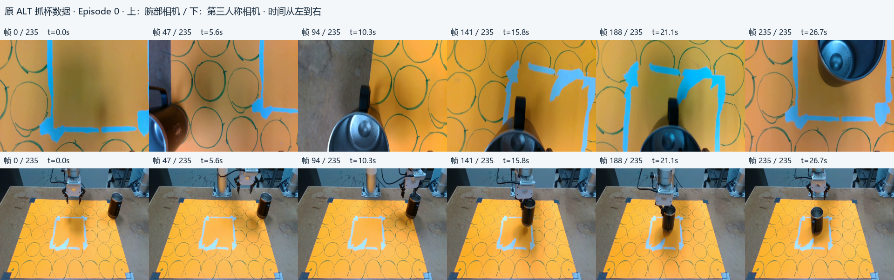
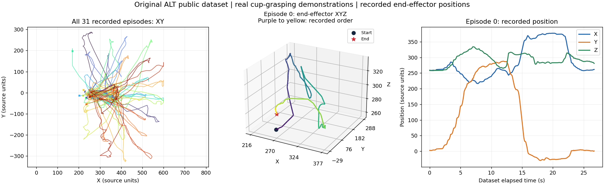

# 原 ALT 抓杯数据的轨迹预览

按用户澄清，本次展示原 ALT 仓库使用的真实机械臂抓杯数据。
只读 `ACl/alt/rgb_training`，没有使用新下载的 Lift 或 Push-T，没有训练或执行机械臂动作。

来源：[原 ALT 仓库](https://github.com/StanfordMSL/alt)，本地 Commit `939ed620276f0088d7e86021dbf1bc37240f02e0`。
[论文 v1 §3.3](https://arxiv.org/html/2505.05787v1#S3.SS3) 描述 30 条不同杯子位置的示范，使用腕部与第三人称相机。
**本地公开主分支实际包含 31 段视频/轨迹、5,775 条状态记录**；没有假定这 31 段恰好就是论文的 30 条实验 ID。
图像取自上游原始视频，坐标取自 Zarr 的 `robot_eef_pos`；方法来源和上游 MIT 文本见根目录 licenses/ALT-MIT.txt。

## 已生成内容

- 第一段 Episode 0 的完整双视角 MP4 和动图：左为腕部相机，右为第三人称相机，内容是已有示范记录。
- Episode 0、10、20 的关键帧拼图：上排腕部、下排第三人称，时间从左到右。
- 空间轨迹图：左侧为全部 31 段末端 XY 路径；中间为 Episode 0 的 XYZ 路径，圆点为起点、星号为终点，紫色到黄色表示先后顺序；右侧为 XYZ 随记录时间变化。
- 图中的轨迹是**末端/夹爪位置**，不是杯子中心的真值轨迹。保持原坐标数值，没有未经核实转换成米或毫米。





完整动画、视频及三段拼图保存在项目内：

`artifacts/visualizations/original_alt_dataset_preview_v3/`

视频为原记录的 10 FPS 顺序，Episode 0 有 236 帧、播放时长 23.6 秒；Zarr 时间戳跨度为 26.701 秒。
画面标注 t 来自原时间戳，不把视频的固定帧率视为严格同步的物理时钟。
动图每隔两帧展示一次，按帧间距设置时长，完整 MP4 保留全部帧。
视频和动图保留在 Git 忽略目录，Git 只提交生成程序、配置、两张小图和来源清单。

## 索引核查

原始 `episode_ends` 的前 30 个边界比实际时间戳跳变位置小 1；时间戳跳变均为 stored_end+1。
按跳变确定的段长和本次三个示范的双相机视频解码帧数逐项相等，分别为 236、186、219。
仅在可视化中使用这些经核对的边界，未修改 Zarr、视频、已有实验或数据划分。
无法独立证明采集硬件的时间延迟，因此只声明结构上的逐帧对应。
全部原边界、可视化边界、原视频 SHA256、坐标数组 SHA256 和产物 SHA256 见 [manifest.json](results/manifest.json)。

## 复现

在项目根目录的 PowerShell 中执行，使用现有只读 Python 解释器；依赖为 NumPy、Zarr、OpenCV、Pillow、Matplotlib、imageio 和 imageio-ffmpeg：

```powershell
& 'D:/Code/Course_code/DP/.conda/pusht/python.exe' -B experiments/original_alt_dataset_preview/visualize.py --output-dir artifacts/visualizations/original_alt_dataset_preview_rerun
```

可用 `--source-root` 指定原 ALT 仓库，或编辑独立 config.json；有 manifest 的旧输出目录不会被覆盖。

运行与检查：前两版发现三维图的色条/说明与轴标签重叠，最终版移除拥挤色条、将时间渐变说明置于标题，并压缩动图；旧版产物仍留在本地原目录。检查原视频解码帧数、时间戳单调性、视频输出帧数、动图总时长，人工检查拼图和轨迹图。未改变数据或选取其他示范来改善展示效果。
